<p align="center">
  
</p>

<h1 align="center">Diorama Maker</h1>

<p align="center"><b>Cut a piece of the Earth out of the map and turn it into a 3D cut-away diorama.</b></p>

<p align="center">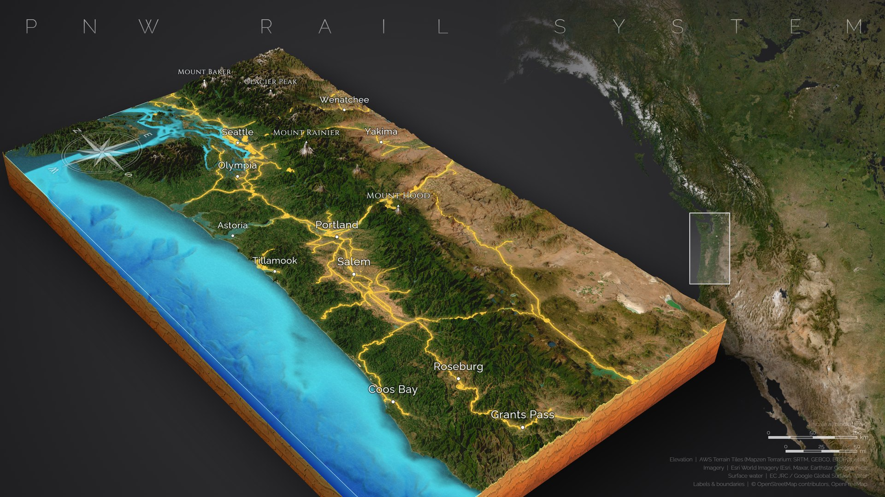</p>

<p align="center"><i>PNW Rail System: the map this guide walks you through, step by step.</i></p>

It runs entirely in your web browser. There is nothing to install apart from Python, and no accounts or API keys are needed.

---

## Contents

| | |
|---|---|
| [Quick start](#quick-start) | Get the app running |
| [What you need](#what-you-need) | The rail file and the settings for this map |
| [The screen at a glance](#screen) | What every button does |
| [Make the PNW Rail System map](#steps) | Eight steps, with pictures |
| [Troubleshooting](#troubleshooting) | Fixes for common problems, step by step |
| [Reference](#reference) | Data sources, limits, how it works |

---

<a id="quick-start"></a>

## Quick start

| 1. Start the server | 2. Open the page |
|---|---|
| Double-click **`serve.bat`**.<br>Or, in a terminal in this folder, run:<br>`python serve.py` | Open your browser to:<br>**http://localhost:5500** |

> [!IMPORTANT]
> Always open the page through **http://localhost:5500**. Double-clicking `index.html` opens it as a file, and nothing will load (see [Troubleshooting → The page is blank](#ts-blank)).

---

<a id="what-you-need"></a>

## What you need

- **The app running** (see [Quick start](#quick-start)) in an up-to-date Chrome, Edge or Firefox, with an internet connection.
- **The rail network:** `hotosm_usa_railways_osm_geojson.zip`, the Humanitarian OpenStreetMap Team's export of every US railway from OpenStreetMap (available on the Humanitarian Data Exchange). Keep it zipped; the app reads the zip directly.

**Every setting used for this map:**

| Step | Setting | Value |
|---|---|---|
| 1. Place | Block shape | **9 : 16** |
| | Area | Mount Baker to just south of Grants Pass, Pacific coast to Yakima (about 426 × 757 km) |
| 2. Detail | Terrain detail / Imagery detail | **1024 · detailed** / **About 8K** |
| 3. Terrain | Everything | left as it is |
| 4. Style | Render style / Rock / View from | **Imagery** / **Sandstone (orange)** / **Southwest** |
| 5. Labels | Show names of | **Cities & towns** and **Landforms & peaks** only; size **1.5×** |
| | Labels list | Seattle, Olympia, Astoria, Tillamook, Portland, Salem, Coos Bay, Roseburg, Grants Pass, Wenatchee, Yakima, Mount Baker, Glacier Peak, Mount Rainier, Mount Hood |
| 6. Shapes | Rail layer | **Draped on terrain**, colour **#ffd23f** (yellow), width **3**, **Glow** on |
| 7. Layout | Title | **PNW Rail System**, at the **Top** |
| | Locator map | **Full side**, on the **Right**, **Direction arrow** off |
| | Compass rose / Credits & scale corner | **On** (Auto position) / **Bottom right** |
| 8. Export | Image size | **3840 × 2160 · 4K**, after zooming the camera in |

---

<a id="screen"></a>

## The screen at a glance

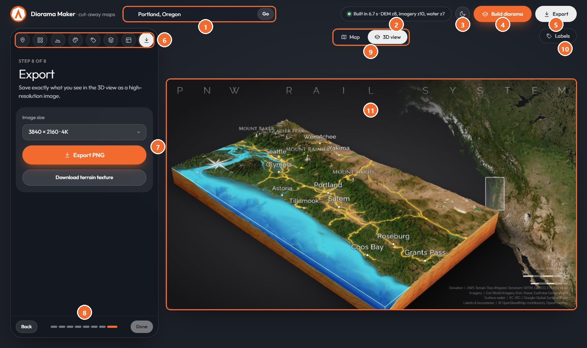

| # | What it is | What it does |
|:-:|---|---|
| 1 | **Search** | Type a place name and press Enter or **Go**; the map flies there. |
| 2 | **Status** | Shows what is happening. It pulses while working and turns **red** if something fails. |
| 3 | **Theme** | Switches the app between dark and light. |
| 4 | **Build diorama** | Downloads terrain, imagery and water for the area and builds the 3D model. |
| 5 | **Export** | Saves the finished picture as a PNG. |
| 6 | **Step icons** | The eight steps: Place, Detail, Terrain, Style, Labels, Pins & shapes, Layout, Export. Click any one to jump to it. |
| 7 | **Settings panel** | The controls for the current step. **Hover any control for a tip.** |
| 8 | **Back / Next** | Walk through the steps in order. |
| 9 | **Map / 3D view** | Switches between the flat map, where you choose the area, and the 3D diorama. |
| 10 | **Labels** | Opens the list of every place name, so you can choose exactly which ones show. |
| 11 | **Preview** | The diorama, framed exactly as it will be exported. Drag to orbit, right-drag to pan, scroll to zoom. |

---

<a id="steps"></a>

## Make the PNW Rail System map

### Step 1: Choose the area

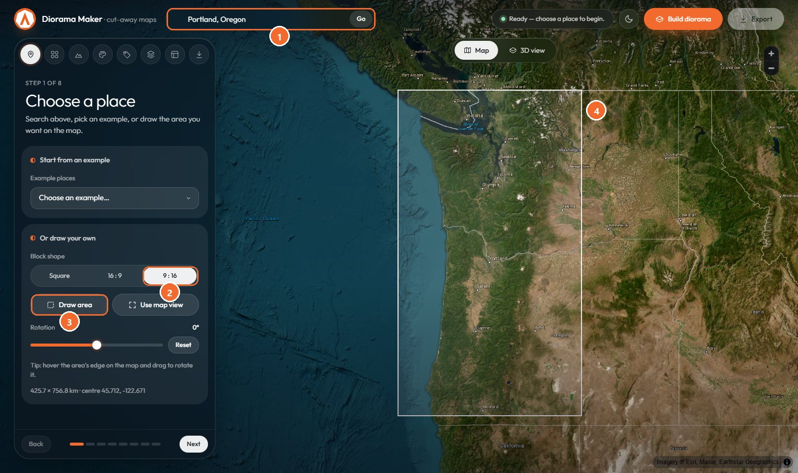

1. **Search** (1) for `Portland, Oregon` and press Enter, then scroll out until you can see from Vancouver Island down to northern California.
2. Under **Block shape**, choose **9 : 16** (2), a tall block.
3. Press **Draw area** (3).
4. Drag a box on the map (4): start in the ocean west of the Olympic Peninsula, level with Mount Baker, and drag down and right to just past Grants Pass and Yakima. The box keeps its 9 : 16 shape as you drag.
5. The panel shows the size. This map is about **426 × 757 km**, centred near **45.71, -122.67**.

To adjust the box afterwards:

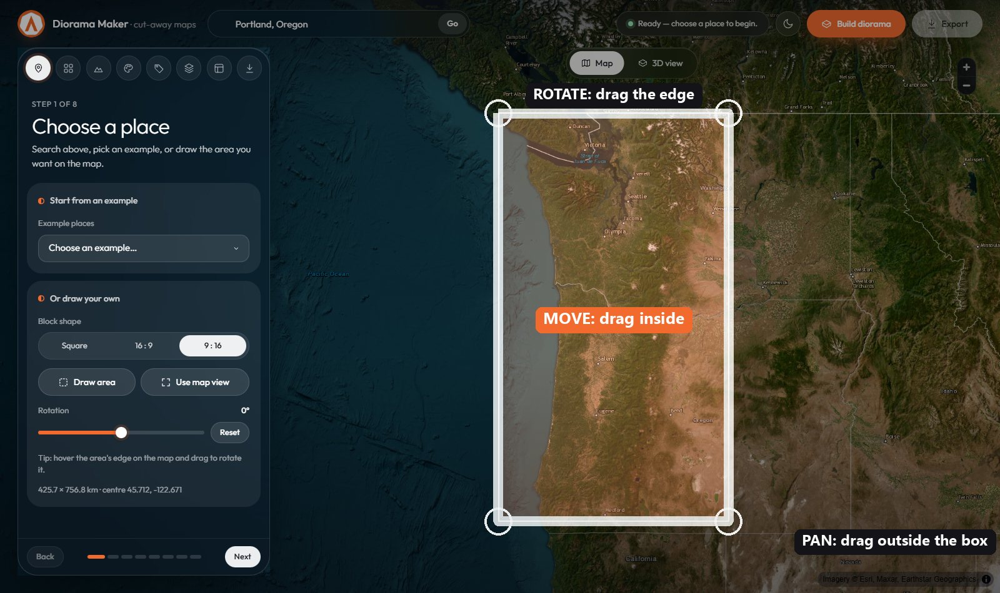

| Where your mouse is | Cursor | Drag to… |
|---|---|---|
| **Inside** the box | Move arrows | **Move** the box |
| **On the edge, or just outside a corner** | Rotate arrow | **Rotate** the box. Leave this map at **0°**; **Reset** puts it back. |
| **Outside** the box | Hand | **Pan** the map |

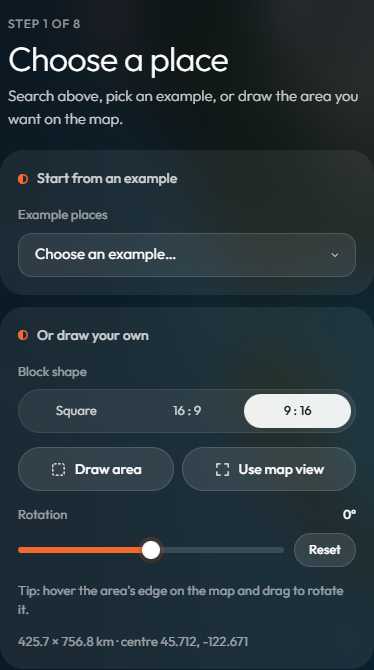

---

### Step 2: Detail

<table><tr>
<td width="320">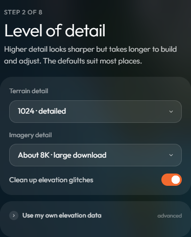</td>
<td>

The area is large, so turn the detail up:

1. **Terrain detail:** **1024 · detailed**.
2. **Imagery detail:** **About 8K**.
3. Leave **Clean up elevation glitches** on.

Then press **Build diorama** at the top right. The status shows progress and reads **Built in …** when it's done. With these settings that usually takes under half a minute.

</td></tr></table>

---

### Step 3: Terrain & water

Nothing to change for this map. **Height exaggeration** sets itself automatically, and the Pacific, Puget Sound and the Columbia are filled from the elevation and surface-water data.

---

### Step 4: Style

<table><tr>
<td width="320">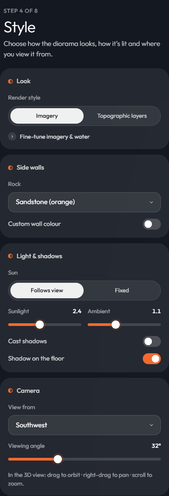</td>
<td>

1. **Render style:** **Imagery**.
2. **Side walls → Rock:** **Sandstone (orange)**.
3. **Light & shadows:** leave the sun on **Follows view**.
4. **Camera → View from:** **Southwest**. This puts the coast along the front-left wall and the north end at the back.

</td></tr></table>

---

### Step 5: Labels

<table><tr>
<td width="320">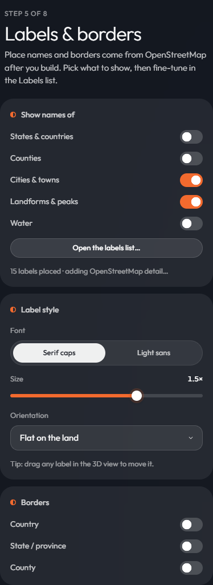</td>
<td>

Names appear a few seconds after the build.

1. Under **Show names of**, turn **off** **States & countries**, **Counties** and **Water**.
2. Leave **Cities & towns** and **Landforms & peaks** **on**.
3. **Font:** **Serif caps**. **Size:** **1.5×**.
4. Leave all **Borders** off.
5. Press **Open the labels list…** to pick the exact names (below).

</td></tr></table>

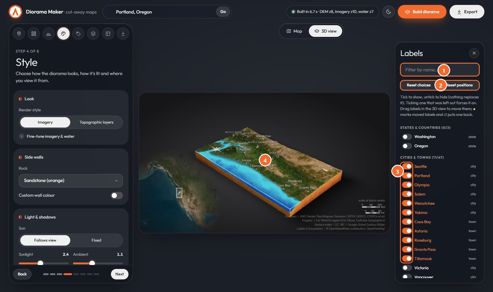

| # | Do this | To… |
|:-:|---|---|
| 1 | Type in **Filter** | find a name quickly |
| 2 | **Reset choices** | start over if you change your mind |
| 3 | **Tick** the names you want and **untick** the rest | Tick these cities and towns: Seattle, Olympia, Astoria, Tillamook, Portland, Salem, Coos Bay, Roseburg, Grants Pass, Wenatchee, Yakima. Under the landforms and peaks, tick Mount Baker, Glacier Peak, Mount Rainier and Mount Hood. Hiding a name never pulls in a replacement. |
| 4 | **Drag a label** in the 3D view | nudge it, if one sits awkwardly |

---

### Step 6: Add the rail lines

<table><tr>
<td width="320">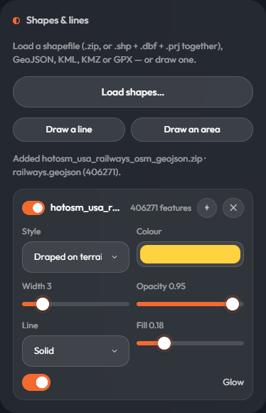</td>
<td>

1. Open **Pins & shapes** and go to the **Shapes & lines** card.
2. Press **Load shapes…** and choose **`hotosm_usa_railways_osm_geojson.zip`**.
3. Wait a few seconds. The note reads **Added … railways.geojson (406271)**: that's every railway in the US, and only the parts inside your box are drawn.
4. Style the new layer:
   - **Style:** **Draped on terrain**.
   - **Colour:** yellow, **#ffd23f**.
   - **Width:** **3**.
   - **Opacity:** **0.95**.
   - **Line:** **Solid**.
   - **Glow:** on.

The rail yards in the file are areas, so they show as small filled patches, as in the finished map.

</td></tr></table>

---

### Step 7: Layout

<table><tr>
<td width="320">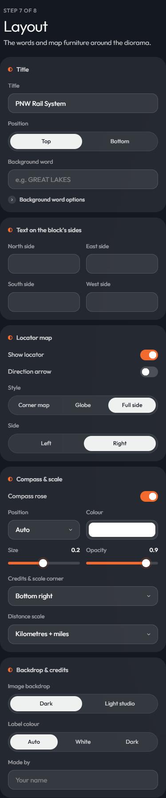</td>
<td>

1. **Title:** type **PNW Rail System**. **Position:** **Top**.
2. Leave **Background word** and all four **Text on the block's sides** boxes empty.
3. **Locator map:**
   - **Show locator:** on.
   - **Direction arrow:** **off**.
   - **Style:** **Full side**.
   - **Side:** **Right**.

   The big map on the right appears a few seconds later, with the ocean cut away so the dark backdrop shows through.
4. **Compass rose:** on, **Position: Auto**, white.
5. **Credits & scale corner:** **Bottom right**.
6. **Distance scale:** **Kilometres + miles**.
7. **Image backdrop:** **Dark**.

</td></tr></table>

---

### Step 8: Frame it and export

<table><tr>
<td width="320"></td>
<td>

1. In the **3D view**, **scroll to zoom in** until the block fills the left two-thirds of the frame and the title runs just above it.
2. Under **Export**, choose **3840 × 2160 · 4K**.
3. Press **Export PNG**. The file downloads as `pnw-rail-system-3840x2160.png`.

</td></tr></table>

| Straight after the build | After zooming in: the finished map |
|---|---|
| 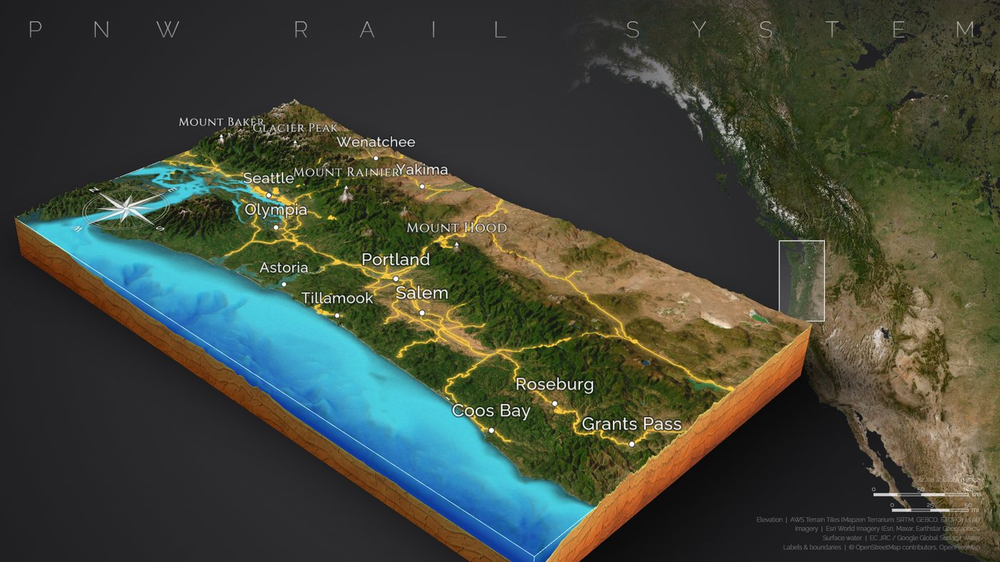 |  |

---

<a id="troubleshooting"></a>

## Troubleshooting

Find your symptom below and follow the steps in order.

<a id="ts-blank"></a>

### 1. The page is blank or the map never appears

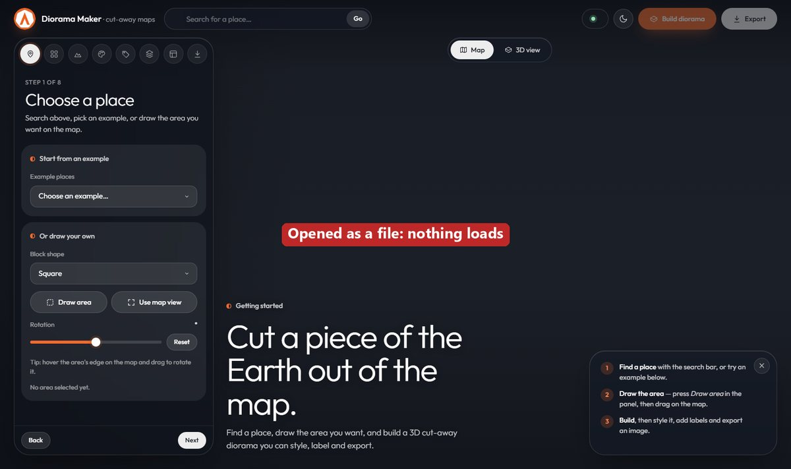

**Cause:** the page was opened as a file (the address starts with `file://` or a drive letter).

1. Close the tab.
2. Double-click **`serve.bat`** in the project folder. A black window opens; **leave it open**.
3. Go to **http://localhost:5500**.
4. If the address can't be reached, see [problem 2](#ts-old).

<a id="ts-old"></a>

### 2. A setting from this guide is missing, or the old version keeps loading

**Cause:** the browser kept an old copy, or a different server is using port 5500.

1. Press **Ctrl + F5** (Mac: **Cmd + Shift + R**) to force a full reload.
2. Still old? Close **every** black server window, then start **`serve.bat`** again.
3. Still old? In a terminal, run:
   ```
   netstat -ano | findstr :5500
   ```
   End the process listed (Task Manager → Details → its PID), then repeat step 2.

### 3. "Build failed" (the status turns red)


1. Check that you're online, then press **Build diorama** again. Most failures are temporary.
2. Lower **Detail → Imagery detail** to **About 4K** and try again.
3. Press **F12 → Console** and read the red message. It names the data source that failed.

### 4. I can't pan or zoom the map


**Cause:** dragging *inside* the box moves it, and dragging *on its edge* rotates it.

1. Start your drag **outside** the box to pan. Scroll to zoom.
2. If you rotated the box by accident, press **Reset** under **Rotation** in the Place step.
3. If **Draw area** is still highlighted, click it again or press **Esc**.

### 5. Some of the 15 names are missing, or others appear


1. Wait 10–20 seconds after **Built…** appears. More names arrive from OpenStreetMap in the background.
2. Check **Labels → Show names of**: only **Cities & towns** and **Landforms & peaks** should be on.
3. Open the **Labels** list, type the missing name in **Filter**, and tick it. Ticking forces it on, even where it would normally be left out.
4. Untick any extra names. They won't be replaced by others.
5. If the panel says the label service is busy, wait a minute and press **Build diorama** again.

### 6. The rail file is slow to load, or an extra layer appears

1. The zip holds a 385 MB file. Give it up to a minute on slower machines, and don't click away while the note says **Reading…**.
2. Only `railways.geojson` should be added. If an older version of the app also added a `metadata.json` layer, remove it with its **✕** button. It's a catalogue record covering the whole USA.
3. If the browser runs out of memory, close other tabs and try again.

### 7. The big locator map on the right is empty

1. It downloads its own map **after** the build, so wait 5–15 seconds.
2. Check **Layout → Locator map**: **Show locator** on, **Style: Full side**.

### 8. Everything is slow or the browser freezes

1. **Terrain detail 1024** with **About 8K** imagery is heavy. While you set things up, use **512** and **About 4K**, then switch back and rebuild just before exporting.
2. Close other heavy tabs. The app uses your graphics card.

> [!NOTE]
> Still stuck? Press **F12 → Console**, copy any red messages, and include them, with what you clicked, when you ask for help.

---

<a id="reference"></a>

## Reference

### Data sources and credits

| Data | Source | Notes |
|---|---|---|
| Elevation | [AWS Terrain Tiles](https://registry.opendata.aws/terrain-tiles/) (Mapzen Terrarium: SRTM, GEBCO, ETOPO1, NED…) | credited in every export |
| Imagery | [Esri World Imagery](https://www.arcgis.com/home/item.html?id=10df2279f9684e4a9f6a7f08febac2a4) | credited in every export; check Esri's terms before commercial use |
| Surface water | EC JRC / Google [Global Surface Water](https://global-surface-water.appspot.com/) (Pekel et al. 2016) | credited in every export; CC-BY 4.0 |
| Labels | © OpenStreetMap contributors (ODbL), via [OpenFreeMap](https://openfreemap.org/) and the [Overpass API](https://overpass-api.de/) | credited in every export |
| Rail lines | © OpenStreetMap contributors (ODbL), exported by the Humanitarian OpenStreetMap Team | covered by the OpenStreetMap credit |
| Search | OpenStreetMap Nominatim | light, interactive use only |

### Known limits

- The free tiles cap detail: imagery up to zoom 17, elevation up to zoom 15, and surface water up to zoom 13 (about 20 m).
- Labels are drawn over the model, so they stay visible behind mountains.
- Drawing the box needs a mouse; touch isn't supported yet.
- Full-side locator: land below sea level would be cut out as if it were sea.

<details>
<summary><b>How it works</b> (for the curious and for developers)</summary>

#### John Nelson's ArcGIS Pro method, and what this app does instead

| ArcGIS Pro step | Here |
|---|---|
| Download a DEM, *Extract by Mask* to a square | Terrarium elevation tiles mosaicked and cut to the block (`geo.js`, `dem.js`) |
| Local scene, ground = clipped DEM, ~25× exaggeration | Custom terrain mesh; auto exaggeration targets relief ≈ 8% of block width (`diorama.js`) |
| World Imagery basemap, hillshade blended in | Esri imagery draped as one texture, soft-light hillshade (`textures.js`) |
| Water polygon at a height + bottom polygon | Water surface mesh at per-cell levels, translucent water walls on the cut faces |
| Dark-to-cyan gradient, ripple picture fill | Depth tint baked into the surface; shader with Fresnel, sun glint and Worley caustics |
| Hand-drawn dirt curtains with rock photo fill | Walls follow the terrain profile; procedural strata in 4 palettes |
| Locator inset with glassy extent box + arrow | Corner map, globe or full-side map (`overlay.js`) |

#### Water model

- **Ocean:** cells below sea level, plus flat cells at sea level with no bathymetry (inner Puget Sound).
- **Lakes and rivers:** the JRC occurrence map; a cell is water if it was water at least *permanence*% of the time.
- **Per-cell surface:** readings from flat water cells and shoreline minima are spread through the water and smoothed, so a river steps down with its valley.
- **Depth:** the deeper of real bathymetry and a synthetic depth that grows with distance from shore, then blurred.

#### Labels

1. **OpenFreeMap vector tiles** give cities, peaks, islands, water names and border lines within about a second.
2. **Overpass** then adds landforms and "which area is this point in" samples.
3. Overlaps are tested on screen, and lower-priority labels are dropped.

#### Files

```
index.html        UI shell (MapLibre + three.js from CDN via import map)
serve.py / .bat   Local no-cache web server on port 5500
img/              Logo and favicons
docs/img/         Pictures used in this README
css/style.css     Design system (dark/light themes)
js/ui.js          Steps, segmented controls, tooltips, theme, status pill, welcome guide
js/main.js        UI wiring, build pipeline, selection move/rotate, live rebuilds, camera, export
js/geo.js         Web Mercator maths, rotated frames, tile mosaics
js/dem.js         Elevation decode/resample, water model, hillshade, GeoTIFF merge
js/diorama.js     The 3D block: terrain, walls, water, topographic terraces, shadows
js/textures.js    Surface composite, borders, procedural rock, caustics
js/vtiles.js      OpenFreeMap vector tiles (labels, rivers, borders)
js/osm.js         Overpass queries (extra labels, water shapes, containment)
js/labels.js      Label drawing, placement, collisions, orientation
js/pins.js        Pin parsing and instanced 3D markers
js/pinimage.js    PNG tracing and extrusion for custom pin heads
js/compass.js     Compass rose
js/overlays.js    Uploaded/drawn shapes and lines (shapefile, GeoJSON, KML/KMZ, GPX; draped or raised)
js/overlay.js     Backdrop, titles, credits, scale bar, locators (shared by preview and export)
```

In the browser console, `window.__diorama` (app state), `window.__map`, `window.__camera` and `window.__controls` are available for debugging.
</details>

<p align="center"><sub>Made by Nomad Data · Inspired by John Nelson's diorama maps</sub></p>
