<p align="center">
  
</p>

<h1 align="center">Diorama Maker</h1>

<p align="center"><b>Cut a piece of the Earth out of the map and turn it into a 3D cut-away diorama</b><br>
in the style of John Nelson's Straits of Mackinac, Puget Sound and Delmarva maps.</p>

<p align="center">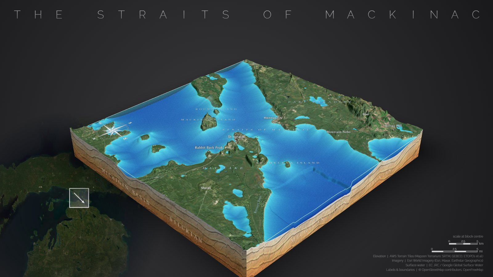</p>

<p align="center">
Pick any place &nbsp;·&nbsp; real terrain and satellite imagery &nbsp;·&nbsp; translucent water &nbsp;·&nbsp; map labels &nbsp;·&nbsp; up to 5,000 pins &nbsp;·&nbsp; export up to 6K
</p>

It runs entirely in your web browser. There is nothing to install apart from Python, and no accounts or API keys are needed.

---

## Contents

| | |
|---|---|
| [Quick start](#quick-start) | Get it running in three steps |
| [The screen at a glance](#screen) | What every button does |
| [Make your first diorama](#steps) | The eight steps, with pictures |
| [Recipes](#recipes) | Settings for popular looks |
| [Troubleshooting](#troubleshooting) | Fixes for common problems, step by step |
| [Reference](#reference) | Pin file format, data sources, limits, how it works |

---

<a id="quick-start"></a>

## Quick start

| 1. Start the server | 2. Open the page | 3. Pick a place and build |
|---|---|---|
| Double-click **`serve.bat`**.<br>Or, in a terminal in this folder, run:<br>`python serve.py` | Open your browser to:<br>**http://localhost:5500** | Click an example such as **Straits of Mackinac**, then press **Build diorama**. |

> [!IMPORTANT]
> Always open the page through **http://localhost:5500**. Double-clicking `index.html` opens it as a file, and nothing will load (see [Troubleshooting → The page is blank](#ts-blank)).

**You need:**
- Python 3. Any recent version works; nothing extra to install.
- An up-to-date Chrome, Edge or Firefox.
- An internet connection, because maps, terrain and labels are downloaded as you go.

---

<a id="screen"></a>

## The screen at a glance

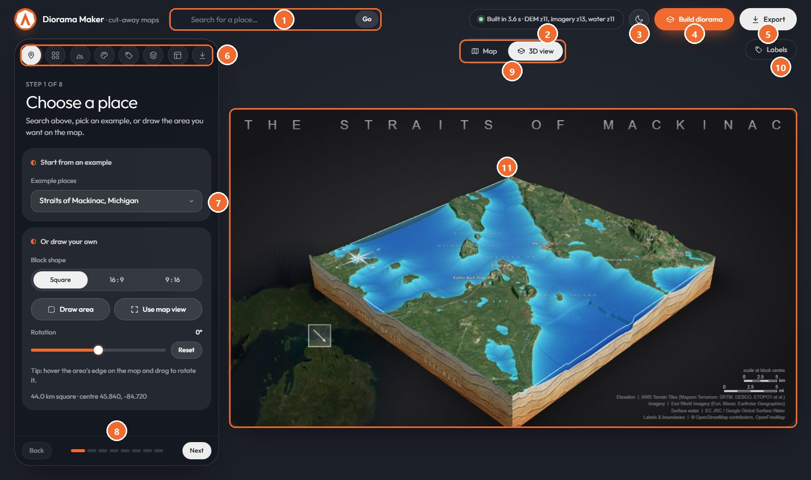

| # | What it is | What it does |
|:-:|---|---|
| 1 | **Search** | Type a place name and press Enter or **Go**; the map flies there. |
| 2 | **Status** | Shows what is happening. It pulses while working and turns **red** if something fails. |
| 3 | **Theme** | Switches the app between dark and light. Your choice is remembered. |
| 4 | **Build diorama** | Downloads terrain, imagery and water for the area and builds the 3D model (a few seconds). |
| 5 | **Export** | Saves the finished picture as a PNG. |
| 6 | **Step icons** | The eight steps: Place · Detail · Terrain · Style · Labels · Pins & shapes · Layout · Export. Click any step to jump to it. |
| 7 | **Settings panel** | The controls for the current step. **Hover any control for a tip.** |
| 8 | **Back / Next** | Walk through the steps in order. The dots show where you are. |
| 9 | **Map / 3D view** | Switches between the flat map, where you choose the area, and the 3D diorama. |
| 10 | **Labels** | Opens the list of every place name, so you can show, hide or force each one. |
| 11 | **Preview** | Your diorama, framed exactly as it will be exported. Drag to orbit, right-drag to pan, scroll to zoom. |

<details>
<summary><b>See the light theme</b></summary>
<br>
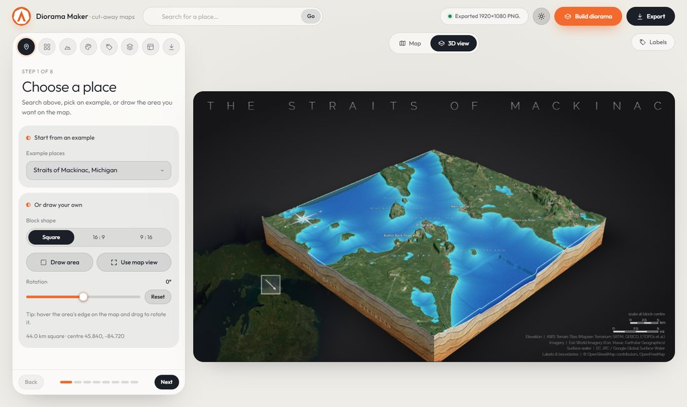

The theme changes only the app. The look of the exported picture is set separately, under **Layout → Image backdrop**.
</details>

---

<a id="steps"></a>

## Make your first diorama, step by step

> [!TIP]
> You don't have to visit every step. **Place → Build → Export** already gives a finished picture. The other steps are for fine-tuning.

### Step 1: Choose a place

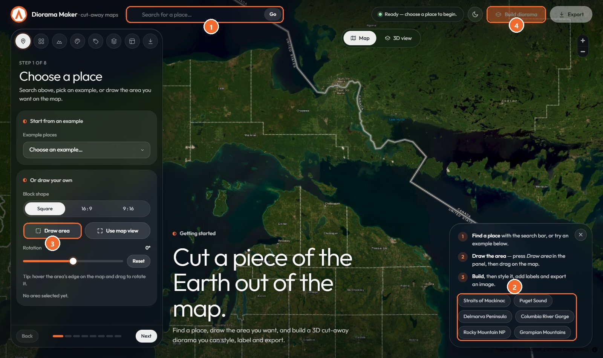

There are three ways to choose an area:

1. **Search** (1) for a place by name, **or**
2. click an **example** (2) (Straits of Mackinac, Puget Sound, Delmarva…), **or**
3. press **Draw area** (3) and drag a box on the map.

Then press **Build diorama** (4).

**Pick the block shape first:** **Square**, **16:9** (wide) or **9:16** (tall). If you change it later, the box keeps its size and centre.

**Adjust the box on the map:**

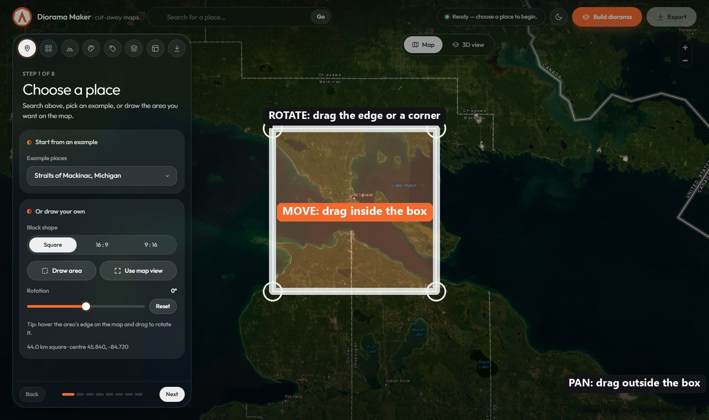

| Where your mouse is | Cursor | Drag to… |
|---|---|---|
| **Inside** the box | Move arrows | **Move** the box |
| **On the edge, or just outside a corner** | Rotate arrow | **Rotate** the box (hold **Shift** to snap to 15°) |
| **Outside** the box | Hand | **Pan** the map (scroll to zoom) |

- **Use map view** drops a box in the middle of whatever you're looking at.
- The **Rotation** slider and **Reset** give exact control over the angle.
- On a rotated block, north still means true north: the compass, the "View from North" camera and the sun direction all follow the rotation.

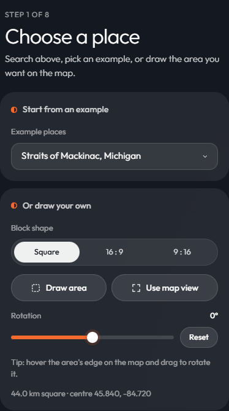

---

### Step 2: Detail

<table><tr>
<td width="320">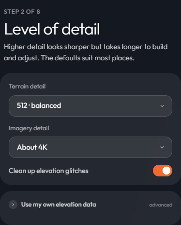</td>
<td>

**Higher detail looks sharper but is slower to build and adjust.**

| You want… | Terrain detail | Imagery detail |
|---|---|---|
| Quick drafts | 256 · quick | About 1K–2K |
| Most uses | **512 · balanced** | **About 4K** |
| Posters and close-ups | 1024 · detailed | About 8K |
| Maximum (slow to adjust) | 1536–2048 | About 8K |

- **Clean up elevation glitches** removes spikes and pits in the source data. Leave it on.
- **Use my own elevation data** lets you load a GeoTIFF, such as lake-bed survey data, which replaces the built-in terrain wherever it has values.

</td></tr></table>

---

### Step 3: Terrain & water

<table><tr>
<td width="320">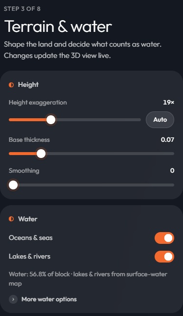</td>
<td>

Changes here update the 3D view live.

- **Height exaggeration:** how much the hills are stretched upward. **Auto** picks a value that makes the relief readable; flat places need more.
- **Base thickness:** how deep the block is below the lowest point.
- **Smoothing:** softens noisy terrain.
- **Oceans & seas:** fills everything below sea level.
- **Lakes & rivers:** fills water found on satellite surface-water maps.

**More water options:**
- **Water must be present at least…%:** raise it to drop seasonal floodplains; lower it to catch more marsh.
- **Sea level:** raise it to simulate flooding.
- **Made-up depth where unknown:** gives lakes a bowl shape where no depth data exists.
- **Backup: detect flat, dark water:** for when the surface-water map has gaps.

</td></tr></table>

---

### Step 4: Style

<table><tr>
<td width="320">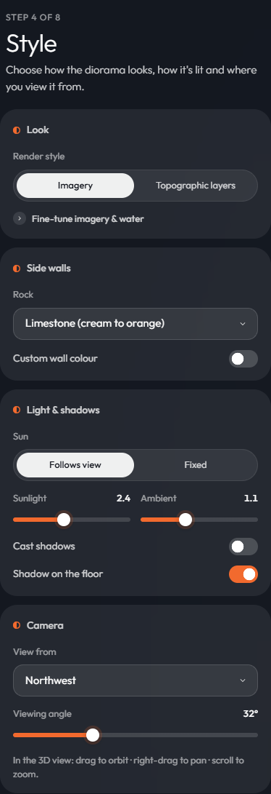</td>
<td>

**Render style:**
- **Imagery:** satellite photos on real terrain, the classic look.
- **Topographic layers:** a stacked-sheet model like a laser-cut contour sculpture. You can set:
  - the number of **layers**;
  - **pre-smoothing**;
  - **colour**: Monotone, Multi-colour, Natural terrain or Satellite;
  - **water**: a coloured surface, coloured depth steps, or the same as land.

**Side walls:** pick a rock (sandstone, limestone, basalt, red clay), or turn on **Custom wall colour**.

**Light & shadows:**
- **Follows view** keeps the model lit from the front.
- **Fixed** lets you place the sun (direction, height, strength).
- **Cast shadows** makes mountains shade the valleys.

**Camera:** pick a **View from** direction and a **Viewing angle**, or just drag in the 3D view.

</td></tr></table>

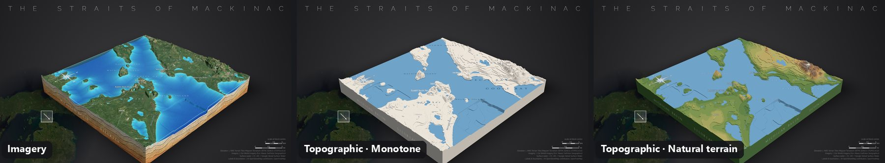

---

### Step 5: Labels & borders

<table><tr>
<td width="320">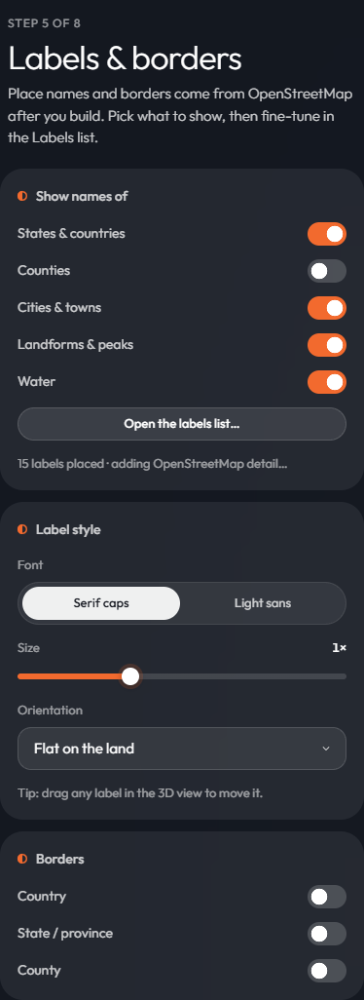</td>
<td>

Names and borders come from OpenStreetMap and appear a moment **after** the build.

1. Choose which kinds of name to show: **States & countries, Counties, Cities & towns, Landforms & peaks, Water**.
2. Pick a **font**, a **size** and an **orientation**:
   - **Flat on the land:** lies on the ground like painted text.
   - **Tilted 30° / 45° / 60°:** leans back from the screen.
   - **Standing:** upright, facing you.
3. Turn on **Borders** for country, state/province and county lines.
4. Press **Open the labels list…** to pick individual names (below).

</td></tr></table>

**The labels list** (the **Labels** tab at the top right of the 3D view):

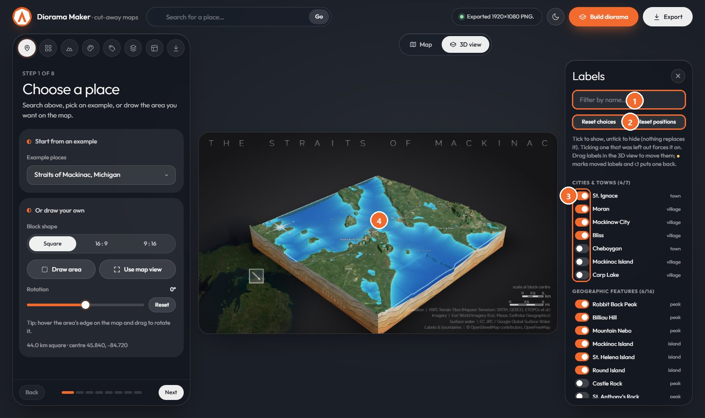

| # | Do this | To… |
|:-:|---|---|
| 1 | Type in **Filter** | find a name quickly |
| 2 | **Reset choices / Reset positions** | go back to automatic |
| 3 | **Tick / untick** a name | show or hide it. Hiding never pulls in a replacement, and ticking a name the app left out forces it on. |
| 4 | **Drag a label in the 3D view** | move it. Moved labels get a ● and a ↺ button to put them back. |

---

### Step 6: Pins & shapes

<table><tr>
<td width="320">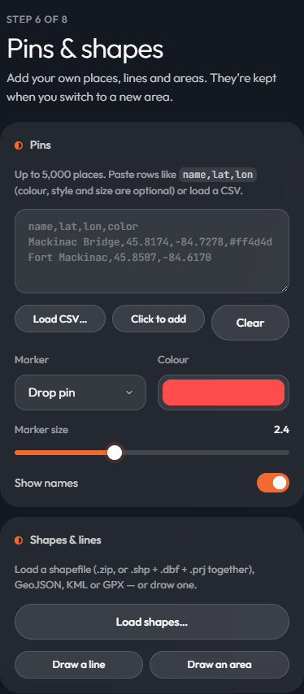</td>
<td>

**Pins (up to 5,000):**
1. Paste rows like `name,lat,lon` into the box, **or** press **Load CSV…**, **or** press **Click to add** and click the map.
2. Choose a **Marker**: drop pin, push pin, flag, floating sphere, floating diamond, light beacon, ground ring, or **custom image**.
3. Set the **Colour**, **Marker size** and whether to **Show names** (names are shown for the first 150).

The note under the controls tells you how many pins landed on the block and how many fell outside it.

**Shapes & lines:**
1. **Upload** a shapefile (`.zip`, or `.shp` + `.dbf` + `.prj` together), GeoJSON, KML, **KMZ** (Google Earth) or GPX, **or** press **Draw line / Draw area** and click points on the map. Double-click or press Enter to finish; Esc cancels.
2. Style each layer: **draped** on the terrain or a **raised 3D line**, plus colour, width, dashes, fill and glow.

</td></tr></table>

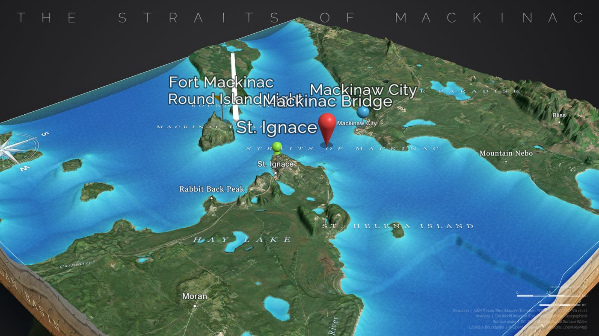

**Custom image pins:** use your own logo or icon as a 3D pin head.

<table><tr>
<td width="320">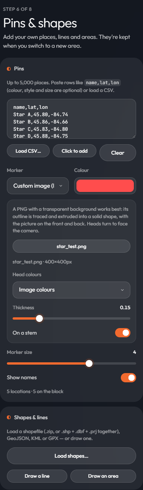</td>
<td>

1. Set **Marker** to **Custom image (PNG)**.
2. Press **Load image…** and choose a **PNG with a transparent background**.
3. Its outline is traced and extruded into a solid head, with your picture on the front and back. Heads always turn to face the camera.
4. Options:
   - **Head colours:** the image's own colours, or a solid silhouette in each pin's colour.
   - **Thickness.**
   - **On a stem**, or standing on the ground.

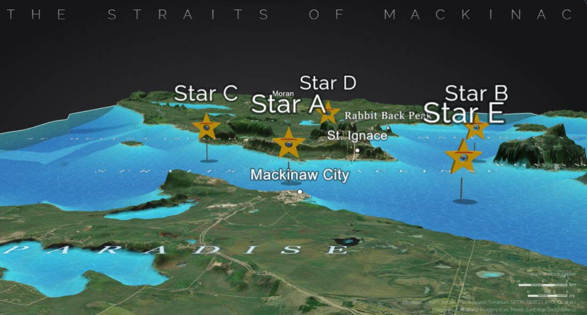

</td></tr></table>

**Drawing a line, then seeing it on the diorama:**

| On the map: click points, then Enter | On the diorama: draped over the terrain |
|---|---|
| 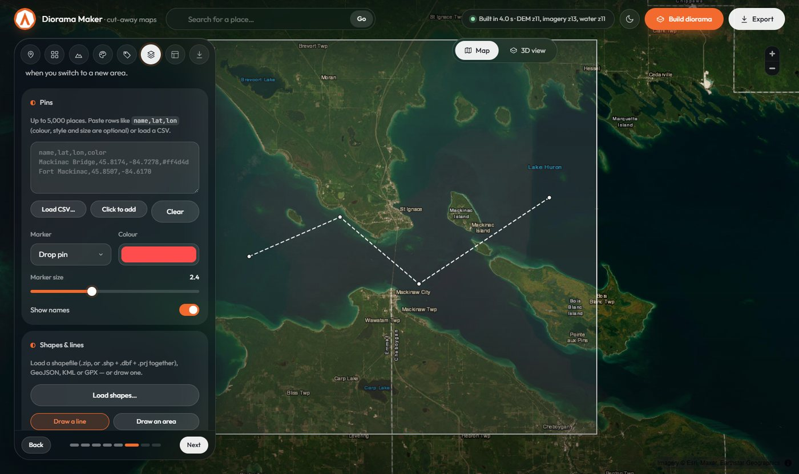 |  |

---

### Step 7: Layout

<table><tr>
<td width="320">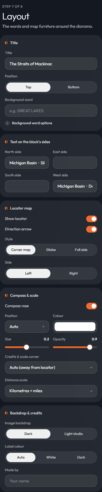</td>
<td>

Everything around the block:

- **Title:** the text, and its position: **Top** or **Bottom**. A bottom title sits *behind* the block, so the diorama overlaps it.
- **Background word:** a huge, faint word behind everything (e.g. GREAT LAKES).
- **Text on the block's sides:** lettering on each wall (N / E / S / W).
- **Locator map:**
  - **Corner map:** a faded inset.
  - **Globe:** a small Earth centred on your area.
  - **Full side:** a big map filling one side, with its water cut out so the backdrop shows through.
- **Direction arrow:** shows which way the camera is looking.
- **Compass rose:** lies flat and points to true north. You can set its position, colour, size and opacity.
- **Credits & scale corner:** Auto, or any corner. In a top corner the scale sits under the credits.
- **Distance scale:** km, miles, both, or off.
- **Image backdrop:** dark, or a light studio background.
- **Label colour.**
- **Made by:** your cartographer credit.

</td></tr></table>

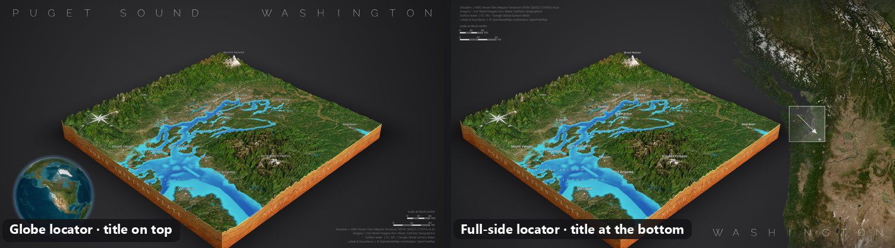

---

### Step 8: Export

<table><tr>
<td width="320">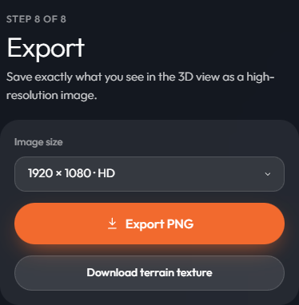</td>
<td>

1. Choose an **Image size**:

   | Size | Good for |
   |---|---|
   | 1920 × 1080 · HD | slides, web, quick checks |
   | 3840 × 2160 · 4K | sharp screens, small prints |
   | 5760 × 3240 · 6K | large posters |

2. Press **Export PNG**. The file downloads named after the title and size, e.g. `the-straits-of-mackinac-3840x2160.png`.

**Download terrain texture** saves just the draped top image, for use in other tools.

> The 3D preview is framed at 16:9 exactly like the export. What you see is what you get, just bigger.

</td></tr></table>

---

<a id="recipes"></a>

## Recipes

<details>
<summary><b>Puget Sound-style poster: big side map with the title along the bottom</b></summary>

1. **Place:** choose the **Puget Sound** example and press **Build diorama**.
2. **Layout → Title → Position:** **Bottom**.
3. **Layout → Locator map → Style:** **Full side**. Set **Side** to **Right**.
4. **Layout → Credits & scale corner:** **Top-left**.
5. Wait a few seconds for the side map to appear, then **Export** at 4K.

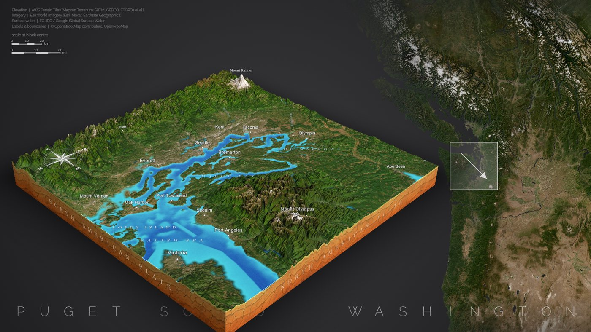
</details>

<details>
<summary><b>White clay contour model</b></summary>

1. **Style → Render style:** **Topographic layers**.
2. **Colour:** **Monotone**, keeping the default clay white.
3. **Light & shadows:** set **Sun** to **Fixed**, put it low (about 25°), and turn on **Cast shadows**.
4. For crisp contours, use **Detail → Terrain detail 512–768**.
</details>

<details>
<summary><b>Trace the Continental Divide</b></summary>

1. **Place:** choose the **Rocky Mountain NP (Continental Divide)** example and build.
2. Download a divide line, for example the USGS Watershed Boundary Dataset (HUC-2 boundaries), as a shapefile `.zip` or GeoJSON.
3. **Pins & shapes → Shapes & lines → Upload** the file.
4. Style it as a **raised 3D line** with **glow**, in a bright colour.
</details>

<details>
<summary><b>Pins with your own icon</b></summary>

1. Make or find a PNG icon with a **transparent background**, roughly square, 200–600 px.
2. Load your locations (CSV with `name,lat,lon`).
3. Set **Marker** to **Custom image (PNG)**, then use **Load image…**.
4. Try **Head colours → Pin colour (silhouette)** with a `color` column to colour-code categories.
</details>

---

<a id="troubleshooting"></a>

## Troubleshooting

Find your symptom below and follow the steps in order.

<a id="ts-blank"></a>

### 1. The page is blank or the map never appears


**Cause:** the page was opened as a file (the address starts with `file://` or a drive letter). Browsers block what the app needs when it's opened that way.

1. Close the tab.
2. Double-click **`serve.bat`** in the project folder. A black window opens; **leave it open**.
3. Go to **http://localhost:5500** in your browser.
4. If the address can't be reached, see [problem 2](#ts-old).

<a id="ts-old"></a>

### 2. New features are missing, or the old version keeps loading

For example, the compass doesn't appear or a new option is missing.

**Cause:** the browser kept an old copy, or a different server is using port 5500.

1. Press **Ctrl + F5** (Mac: **Cmd + Shift + R**) to force a full reload.
2. Still old? Close **every** black server window, then start **`serve.bat`** again. Its built-in server tells the browser not to cache files.
3. Still old? Something else may be using port 5500. In a terminal, run:
   ```
   netstat -ano | findstr :5500
   ```
   End the process listed, using Task Manager → Details → its PID, then repeat step 2.

### 3. "Build failed" (the status turns red)


**Cause:** a download failed. That can be a dropped connection, a busy tile server, or an area too big for the chosen detail.

1. Check that you're online, then press **Build diorama** again. Most failures are temporary.
2. Lower **Detail → Imagery detail** to **About 2K** and try again.
3. If the area is very large (a whole country, say), make the box smaller.
4. Press **F12 → Console** and read the red message. It names the data source that failed.

### 4. I can't pan or zoom the map


**Cause:** dragging *inside* the box moves the box, and dragging *on its edge* rotates it, so neither pans the map.

1. Start your drag **outside** the box to pan.
2. Scroll the mouse wheel to zoom, or use the **+ / −** buttons at the top right.
3. If **Draw area**, **Click to add** or **Draw line** is still active (its button is highlighted), click it again or press **Esc** to leave that mode.

### 5. Labels are missing, few, or in odd places


**Cause:** labels appear a moment after the build. Extra detail comes from a shared public service (Overpass) that is sometimes busy.

1. Wait 10–20 seconds after **Built…** appears. The Labels step shows "adding OpenStreetMap detail…" while it works.
2. Check the toggles in **Labels → Show names of**.
3. Open the **Labels** list and tick a missing name to force it on.
4. If a name sits in the wrong spot, **drag it** in the 3D view.
5. If the panel says the label service is busy, wait a minute and press **Build diorama** again. Basic labels from map tiles still show meanwhile.

### 6. Some pins don't appear

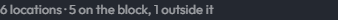

1. Read the note under the pin controls. It counts pins **on the block** and **outside it**. Only pins inside the box are drawn.
2. Check the column order. Without a header row the order must be `lat,lon,…`. **Latitude comes first** (Mackinac is `45.8, -84.7`).
3. Add a header row (`name,lat,lon`) so columns are found by name.
4. More than 5,000 rows? The rest are ignored, and the note says so.
5. Pins are there but tiny? Raise **Marker size**.

### 7. My image pins show as drop pins, or as solid squares

1. **Drop pins:** no image has loaded yet. Press **Load image…** again and check the message under it.
2. **Squares:** the image has no transparency, so its whole rectangle is traced. Remove the background in an image editor and save as **PNG**.
3. **Jagged edges:** use a larger image (at least 200 px), and avoid very thin lines.

### 8. Everything is slow or the browser freezes

1. Lower **Detail → Terrain detail** to **512** or **384**. This has the biggest effect.
2. Lower **Imagery detail** to **About 2K**.
3. **Topographic layers** with many layers are heavy. Reduce **Layers**, or tune at 512 and raise detail just before export.
4. Thousands of pins: turn off **Show names**, and use simple markers (sphere or ring).
5. Close other heavy tabs. The app uses your graphics card.

### 9. Water looks wrong (rivers missing, land flooded, lakes flat)

1. **Narrow rivers missing:** they are thinner than one terrain cell. Raise **Terrain detail**, or draw the river with **Shapes & lines**.
2. **Land shown as water:** in **Terrain → More water options**, raise **Water must be present at least…%**.
3. **Coast flooded or dry:** check **Sea level**. It should be **0** unless you're simulating a change.
4. **Lake looks like a flat sheet:** turn on **Made-up depth where unknown**.

### 10. The full-side locator is empty

1. It downloads its own map **after** the build, so wait 5–15 seconds.
2. Make sure **Show locator** is on.
3. For continent-sized areas there's little surrounding land left to show. Use **Globe** instead.

### 11. My shapefile or KMZ won't load

1. Choose **all** the parts at once (`.shp`, `.dbf`, `.prj`), or zip them and upload the `.zip`.
2. The `.prj` is needed to place the shapes correctly; without it, coordinates are assumed to be longitude/latitude.
3. Check that the shapes overlap your box. Use the layer's **zoom-to** button on the map.
4. **KMZ from Google Earth:** only placemarks are drawn: points, lines and polygons, including those inside folders. Image overlays, 3D models and network links that fetch data from the web are skipped. If the message says "no placemarks", re-save it from Google Earth with the placemarks inside the file rather than linked.

> [!NOTE]
> Still stuck? Press **F12 → Console**, copy any red messages, and include them, with what you clicked, when you ask for help.

---

<a id="reference"></a>

## Reference

### Pin file format

Only latitude and longitude are required. A header row lets you add more columns in any order:

| Column | Also accepted as | Example |
|---|---|---|
| `lat` | `latitude`, `y` | `45.8174` |
| `lon` | `lng`, `long`, `longitude`, `x` | `-84.7278` |
| `name` | `label`, `title`, `place`, `location` | `Mackinac Bridge` |
| `color` | `colour`, `hex` | `#ff4d4d` or `gold` |
| `style` | `marker`, `icon`, `symbol`, `type` | `drop`, `pushpin`, `flag`, `sphere`, `diamond`, `beacon`, `ring`, `image` |
| `size` | `scale` | `1.5` (multiplies the panel size) |

```csv
name,lat,lon,color,style,size
Mackinac Bridge,45.8174,-84.7278,#ff4d4d,drop,1
Fort Mackinac,45.8507,-84.6170,gold,flag,1.5
```

Commas, tabs or semicolons all work. Lines starting with `#` are ignored.

### Data sources and credits

These credits are drawn into every export automatically.

| Data | Source | Notes |
|---|---|---|
| Elevation | [AWS Terrain Tiles](https://registry.opendata.aws/terrain-tiles/) (Mapzen Terrarium: SRTM, GEBCO, ETOPO1, NED…) | up to zoom 15 |
| Imagery | [Esri World Imagery](https://www.arcgis.com/home/item.html?id=10df2279f9684e4a9f6a7f08febac2a4) | check Esri's terms before commercial use |
| Surface water | EC JRC / Google [Global Surface Water](https://global-surface-water.appspot.com/) (Pekel et al. 2016) | CC-BY 4.0, about 30 m |
| Labels and borders | © OpenStreetMap contributors (ODbL), via [OpenFreeMap](https://openfreemap.org/) tiles and the [Overpass API](https://overpass-api.de/) | Overpass is rate-limited and shared |
| Search | OpenStreetMap Nominatim | light, interactive use only |

### Known limits

- The free tiles cap detail: imagery up to zoom 17, elevation up to zoom 15, and surface water up to zoom 13 (about 20 m).
- Rivers narrower than one terrain cell (block width ÷ terrain detail) don't show as water.
- Labels are drawn over the model, so they stay visible behind mountains.
- Drawing the box and clicking to add pins need a mouse; touch isn't supported yet.
- Full-side locator: land below sea level would be cut out as if it were sea.

<details>
<summary><b>How it works</b> (for the curious and for developers)</summary>

#### John Nelson's ArcGIS Pro method, and what this app does instead

| ArcGIS Pro step | Here |
|---|---|
| Download a DEM, *Extract by Mask* to a square | Terrarium elevation tiles mosaicked and cut to the (optionally rotated) block (`geo.js`, `dem.js`) |
| Local scene, ground = clipped DEM, ~25× exaggeration | Custom terrain mesh; auto exaggeration targets relief ≈ 8% of block width (`diorama.js`) |
| World Imagery basemap, hillshade blended in | Esri imagery draped as one texture, soft-light hillshade (`textures.js`) |
| Water polygon at a height + bottom polygon | Water surface mesh at per-cell levels, translucent water walls on the cut faces |
| Dark-to-cyan gradient, ripple picture fill | Depth tint baked into the surface; shader with Fresnel, sun glint and Worley caustics |
| Hand-drawn dirt curtains with rock photo fill | Walls follow the terrain profile; procedural strata in 4 palettes, or a custom tint |
| Rotated italic labels, "hovering" labels | Perspective labels with gradient fill and offset shadow (`labels.js`) |
| Locator inset with glassy extent box + arrow | Corner map, globe or full-side map; the arrow follows the camera (`overlay.js`) |

#### Water model

- **Ocean:** cells below sea level, plus flat cells at sea level with no bathymetry (inner Puget Sound).
- **Lakes and rivers:** the JRC occurrence map; a cell is water if it was water at least *permanence*% of the time.
- **Per-cell surface:** readings from flat water cells and shoreline minima are spread to the rest of the water and smoothed, so a river steps down with the valley instead of filling to one level.
- **Depth:** the deeper of real bathymetry and a synthetic depth that grows with distance from shore, then blurred to hide seams between data sources.

#### Labels

1. **OpenFreeMap vector tiles** give cities, peaks, islands, water names and border lines within about a second.
2. **Overpass** then adds county names, ranges, peninsulas and glaciers, plus "which area is this point in" samples, so state names stay on their own side of a border.
3. Overlaps are tested on screen, and lower-priority labels are dropped.

#### Custom image pins

The PNG's alpha channel is thresholded, traced along pixel edges into outlines (holes and islands included), simplified (Douglas–Peucker plus a corner-cutting pass) and extruded with three.js. The caps keep UVs, so the image maps straight onto the front and back. Big pin sets use coarser tracing and simpler markers.

#### Files

```
index.html        UI shell (MapLibre + three.js from CDN via import map)
serve.py / .bat   Local no-cache web server on port 5500
img/              Logo and favicons
docs/img/         Pictures used in this README
css/style.css     Design system (dark/light themes)
js/ui.js          Steps, segmented controls, tooltips, theme, status pill, welcome guide
js/main.js        UI wiring, build pipeline, selection move/rotate, live rebuilds, camera, export
js/geo.js         Web Mercator maths, rotated frames, tile mosaics
js/dem.js         Elevation decode/resample, water model, hillshade, GeoTIFF merge
js/diorama.js     The 3D block: terrain, walls, water, topographic terraces, shadows
js/textures.js    Surface composite, borders, procedural rock, caustics
js/vtiles.js      OpenFreeMap vector tiles (labels, rivers, borders)
js/osm.js         Overpass queries (extra labels, water shapes, containment)
js/labels.js      Label drawing, placement, collisions, orientation
js/pins.js        Pin parsing and instanced 3D markers
js/pinimage.js    PNG tracing and extrusion for custom pin heads
js/compass.js     Compass rose
js/overlays.js    Uploaded/drawn shapes and lines (shapefile, GeoJSON, KML/KMZ, GPX; draped or raised)
js/overlay.js     Backdrop, titles, credits, scale bar, locators (shared by preview and export)
```

In the browser console, `window.__diorama` (app state), `window.__map`, `window.__camera` and `window.__controls` are available for debugging.
</details>

<p align="center"><sub>Made by Nomad Data · Inspired by John Nelson's diorama maps</sub></p>
